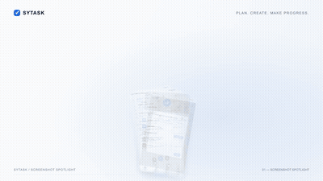

# screenshot-motion-skill

**English** | [简体中文](README.zh-CN.md)

**Your screenshots. A product video. Ready for your next launch.**

An agent skill that turns screenshots into motion, writes the captions, and delivers an MP4. Storybook also exports native editable Jianying drafts with replaceable screenshots and page text; other templates offer desktop editing packs.

## Effects

| Spotlight | Launch |
| :---: | :---: |
|  |  |
| **Storybook** | **Orbit** |
|  |  |
| **Kinetic** | **Prism** |
|  |  |

<sub>Small, accelerated, silent previews. Final videos: 1080p · 30 fps.</sub>

## Keep creating in Jianying: replace screenshots and edit page text

**Storybook exports a native editable Jianying draft.** Continue working in the desktop editor after generation: replace product screenshots, revise page copy, and refine the edit.


<sub>Actual Jianying macOS 11.8.0 capture. The book preview appears above independent text tracks; screenshot images, paper and background also have their own layers.</sub>

- **Replace screenshots:** each screenshot is an image segment. Choose “替换片段” (Replace clip) and keep “复用原视频效果” (Reuse original effects) checked to retain placement and keyframes.
- **Edit page copy:** cover titles, body copy, chapter labels and page numbers are native text segments available in the text panel.
- **Keep the book layout:** covers, facing pages, colors and decorations follow the template layout, with synchronized keyframes for page changes.

Ask your agent:

```text
Make a Storybook video and export a native editable Jianying draft.
I want to replace screenshots and edit cover and page text in Jianying,
while preserving as much of the original layout and effect as possible.
```

**Current scope:** native editable export is Storybook-only. Draft opening, layout display and screenshot replacement were verified on Jianying macOS 11.8.0. Text-edit/save/reopen and final video export have not completed acceptance testing. Native horizontal folding approximates the original animation; curved paper, perspective and dynamic shadows are not identical. Windows and CapCut are unverified. [Editing and compatibility →](references/editor-export.md)

## How to use

**1. Install.** Open a local project in your app and paste the matching line into its **chat box**:

| App | Paste this to install |
| --- | --- |
| **Codex** | $skill-installer Install https://github.com/simwy/screenshot-motion-skill as screenshot-motion-skill. |
| **Claude Code** | Install https://github.com/simwy/screenshot-motion-skill into .claude/skills/screenshot-motion-skill in this project. |
| **WorkBuddy** | Install https://github.com/simwy/screenshot-motion-skill into .codebuddy/skills/screenshot-motion-skill in this project. |
| **DeepSeek Harness** | Install https://github.com/simwy/screenshot-motion-skill into .dsh/skills/screenshot-motion-skill in this project. |

Once the agent confirms installation, start a new task in the same project. These instructions target local agents with file and command access; “Claude” here means **Claude Code**. [Help with installation →](references/installation.md)

**2. Attach your screenshots.** Attach **five screenshots** in the chat box. Storybook can use 1–12 screenshots instead. You can send the images and the text below **together in one message**.

**3. Add your app details and pick an effect.** Paste this example alongside your attachments, replace the app name and description with your own, and send. The app name is simply a line of text—no separate form or command is needed.

```text
Use screenshot-motion-skill to make a promotional video from the attached screenshots.

App name: FocusFlow
What it does: A task planner that helps people organize their day and stay focused.
Effect: orbit
Caption language: English. Write short captions for me.
Output: Export the MP4.
Screenshot order: Use the attachment order.
```

Replace `orbit` with any effect above: **`spotlight` · `launch` · `storybook` · `orbit` · `kinetic` · `prism`**.

Your agent writes the copy, creates the animation, checks the result, and delivers the video. You can then say “Change the headline” or “Also export an editing pack for Jianying or CapCut.”

## What you get

- **A finished MP4** and the editable source project.
- **Optional music and sound effects** from audio you provide.
- **An optional editing pack** with clean motion clips, editable SRT captions, separate audio tracks, and your screenshots.

- **An optional native Storybook draft for Jianying** with replaceable screenshots, separate text layers and page keyframes. See the showcase above for compatibility and validation scope.

## Good to know

- Output is **1080p, 30 fps, landscape**. Spotlight: 12s · Launch: 20s · Orbit: 18s · Kinetic: 16s · Prism: 18s · Storybook: 32s for five pages, with adjustable holds.
- Use clear screenshots and short captions. Changing text inside a screenshot requires an updated image.
- Audio is not bundled; provide files you have permission to use. The agent checks the required local rendering tools. [Setup details →](references/development.md)
- Original code is MIT licensed; Remotion and media have separate terms. [License details →](THIRD_PARTY_NOTICES.md)

## More effects, same skill

The template library can grow without replacing existing effects. [Contribute an effect →](references/extending.md)

Only lightweight GIF previews and the Jianying UI showcase capture ship with the skill. Full demo videos, original screenshots, runtime dependencies, and generated editing packs stay outside the installation. [Preview details →](docs/previews/README.md)
