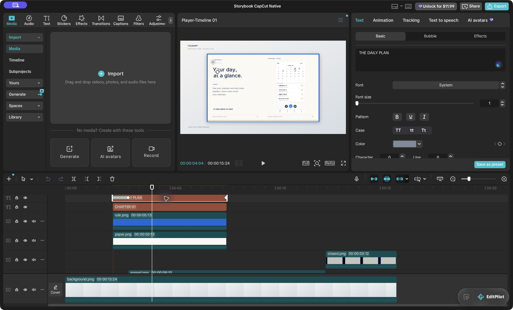

# screenshot-motion-skill — Screenshots to product videos

**English** | [简体中文](README.zh-CN.md)

Give your AI coding agent product screenshots, a product name and a short description. Pick a template and generate an animated product video locally—with promotional copy. Use it for app, website and SaaS demos, launches and social posts without writing animation code.

Revise headlines, copy or screenshots in conversation, then render again. Request an editable Jianying draft when you want to continue in a desktop editor.

[How to use](#how-to-use) · [Deliverables](#deliverables) · [Templates](#templates) · [Jianying export](#jianying-export) · [FAQ](#faq)

## Templates

| Spotlight | Launch |
| :---: | :---: |
|  |  |
| **Storybook** | **Orbit** |
|  |  |
| **Kinetic** | **Prism** |
|  |  |
| **Flipstack** | **Entrance** |
|  |  |

## How to use

### 1. Install the skill

Run this in your project terminal and select your coding agent when prompted:

```sh
npx skills add simwy/screenshot-motion-skill
```

Start a new task in the same project. Your agent must be able to read local files and run commands.

### 2. Attach screenshots and describe your video

Send your screenshots and this prompt together, replacing the product details:

```text
Use screenshot-motion-skill to make a promotional video from the attached screenshots.

App name: FocusFlow
Description: A task planner that helps teams organize work and track progress.
Template: orbit
```

Storybook supports **1–12 screenshots**; every other template requires **exactly five**. Attachment order is preserved unless you specify otherwise. If the count is outside the template range, the agent asks you to add images, choose images to remove or change templates. It does not duplicate or discard screenshots automatically.

The agent writes short copy from your screenshots and description, checks dependencies, renders and checks the result. You can also supply your own copy. Copy language defaults to the language inferred from the app name, and delivery defaults to MP4. You can request a different language or an editable draft when needed.

### 3. Revise or request a draft

```text
Change the headline to “Keep your team moving” and replace screenshot three with the new attachment.
Also generate a portable Jianying draft ZIP with media so I can keep editing.
```

Local rendering requires **Python 3.9+, Node.js 22+, npm, Chrome / Chromium and FFmpeg**. The first run installs rendering dependencies. Native draft generation additionally requires pyJianYingDraft 0.2.7 and Pillow. See [environment setup](references/development.md).

## Deliverables

| Output | When delivered | Purpose |
| --- | --- | --- |
| Finished MP4 | Default | 1080p, 30 fps, landscape, with no audio track; ready to play and share |
| Portable Jianying draft ZIP | On request, for seven templates excluding Entrance | Draft data, screenshots, separate copy and an installer for continued editing |
| Jianying `.jypack` | Only when explicitly requested | Packaged through the desktop client for its Import Jianying Draft command |

Rendering projects and source files are retained for revisions, not included by default. Entrance currently delivers MP4 without a native editor draft.

## Jianying export

**Screenshots, promotional text and animation layers remain separate.** Native drafts contain original images, editable text segments and keyframes for replacing screens, revising headlines and continuing your edit. Text inside screenshots remains part of the image.

- **Seven native draft recipes:** Spotlight, Launch, Storybook, Orbit, Kinetic, Prism and Flipstack. Entrance has no native draft recipe yet.
- **Motion is an approximation:** drafts do not reproduce every Remotion perspective, curved page mesh, shadow, blur or typographic detail. Use the finished MP4 for the full template rendering.
- **Keep effects when replacing images:** in Jianying, use Replace Clip with “复用原视频效果” enabled to retain placement and keyframes. Images repeated across segments must be replaced in each occurrence or regenerated through the skill.
- **Compatibility is version-specific:** earlier Storybook opening and screenshot replacement were checked in Jianying macOS 11.8.0. The other six recipes are experimental. Full GUI acceptance of the all-template installer and Windows clients remains pending.

### Choose ZIP or .jypack

| | Portable draft ZIP | `.jypack` |
| --- | --- | --- |
| Generation | No Jianying client required | Requires the Jianying desktop client and UI access |
| Recipient workflow | Unzip and follow the included Python installer instructions for the actual draft directory | Do not unzip; use “导入剪映草稿” on the Jianying home screen |
| Media | Included; paths are updated during installation | Included through the client’s backup-with-media command |

**A regular ZIP cannot be imported through Import Jianying Draft or renamed to `.jypack`.** Explicitly request “MP4 and a Jianying .jypack including media” for that workflow. The receiving editor must have the import feature.

### CapCut

Request CapCut explicitly. It uses a separate adapter and an empty project created in the target installed build, not Jianying’s `.jypack` workflow.



This earlier CapCut macOS 9.7.1 capture demonstrates opening and image/text tracks. Screenshot replacement, text-edit/save/reopen and final export remain unverified there. See [editor compatibility](references/editor-export.md) and [.jypack export](references/jianying-jypack.md).

## FAQ

### Do I need to code or use Jianying?

Describe your request in chat and let the agent run the scripts. MP4 generation does not require Jianying. A desktop editor is only needed to continue editing drafts. You still need the local rendering environment listed above.

### Is this a web app?

It is a skill for local AI coding agents, not a hosted video editor. Developers can also call the engine directly; see [engine and cloud integration](references/engine.md).

### Do I need a video-generation API key?

No separate video-generation key is required. Fixed templates render locally with Remotion. Your AI agent still requires its own account or model configuration, which may incur charges.

### Can the agent write the copy?

Yes. Supply screenshots, a product name and a short description, or provide your own per-screen titles and descriptions. Specify the language you want. Long text or replacement images with different proportions may require layout adjustments.

### Can I edit text inside screenshots?

Separate video headlines and promotional text are editable. Text baked into screenshots requires updated images.

### Can I add music or narration?

The skill produces silent visuals without music, sound effects or narration. You can add audio you have permission to use during subsequent editing.

### Why does the draft look different from the MP4?

The two renderers have different capabilities. MP4 preserves the full template effect; native drafts prioritize editable images, text and keyframes, simplifying some complex motion. Save, reopen and final export still need verification in the target client.

### Is commercial use allowed?

Original code is MIT licensed. Remotion, your AI agent and any images or fonts have separate terms. Review the [third-party notices](THIRD_PARTY_NOTICES.md) before commercial use.

### What if rendering fails?

Ask the agent to check dependencies and screenshot counts first. When [opening an issue](https://github.com/simwy/screenshot-motion-skill/issues), include your OS, agent, template and error details. Omit credentials and private media.

## Further reading

[Configuration](references/configuration.md) · [Template parameters](references/templates.md) · [Development and setup](references/development.md) · [Add a template](references/extending.md) · [Preview details](docs/previews/README.md)
