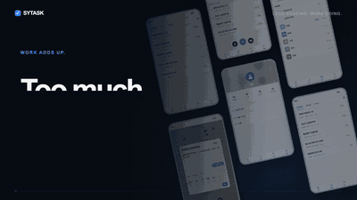
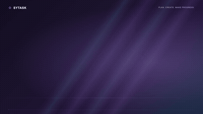

# screenshot-motion-skill — Screenshots to product demo videos

**English** | [简体中文](README.zh-CN.md)

**Give your AI coding agent screenshots. Get a product video for your next launch.**

`screenshot-motion-skill` is an open-source agent skill for Codex, Claude Code, and other local AI coding assistants. Turn app, website, or SaaS screenshots into animated product demo videos, write captions, and render a 1080p MP4 locally with Remotion.

- **Eight motion templates:** spotlight cards, dark launch films, page-turn storybooks, orbital galleries, kinetic graphics, prismatic folds, floating page stacks, and gentle fan entrances.
- **Revise in conversation:** change headlines, captions, and effects, then render again.
- **Keep editing:** receive the Remotion source project, with an experimental native Jianying preview draft for the original seven effects; desktop editing packs and CapCut drafts are also available.

[Quick start](#how-to-use) · [Outputs](#what-you-get) · [Requirements](#requirements) · [FAQ](#faq)

## Effects

| Spotlight | Launch |
| :---: | :---: |
|  |  |
| **Storybook** | **Orbit** |
|  |  |
| **Kinetic** | **Prism** |
|  |  |
| **Flipstack** | **Entrance** |
|  |  |

<sub>Small, accelerated, silent previews. Final videos: 1080p · 30 fps.</sub>


### Eighth template: Entrance

Choose `entrance` for an 8-second video using five screenshots: cards rise in a gentle fan, product copy fills the left side, feature descriptions light up on the right, then the cards spread out and the center card lifts beneath the closing title. Copy, labels and accent color are configurable. Supports 1080p MP4, Remotion source, clean plates and portable editing packs. Native Jianying/CapCut drafts are not yet supported for Entrance. [Example configuration](examples/entrance.json) · [Copy mapping](references/templates.md#entrance--8-seconds)

## How to use

### Install with the skills CLI

Run this in your project terminal and select your agent when prompted:

```sh
npx skills add simwy/screenshot-motion-skill
```

This installs the skill and its supporting files. Rendering dependencies are separate; see [Requirements](#requirements). Prefer installing through chat? Use the instructions below.

**1. Install.** Open a local project in your app and paste the matching line into its **chat box**:

| App | Paste this to install |
| --- | --- |
| **Codex** | $skill-installer Install https://github.com/simwy/screenshot-motion-skill as screenshot-motion-skill. |
| **Claude Code** | Install https://github.com/simwy/screenshot-motion-skill into .claude/skills/screenshot-motion-skill in this project. |
| **WorkBuddy** | Install https://github.com/simwy/screenshot-motion-skill into .codebuddy/skills/screenshot-motion-skill in this project. |
| **DeepSeek Harness** | Install https://github.com/simwy/screenshot-motion-skill into .dsh/skills/screenshot-motion-skill in this project. |

Once the agent confirms installation, start a new task in the same project. These instructions target local agents with file and command access; “Claude” here means **Claude Code**. [Help with installation →](references/installation.md)

**2. Attach your screenshots.** Attach **five screenshots** in the chat box. Storybook can use 1–12 screenshots instead. You can send the images and the text below **together in one message**.

**3. Add your app details and pick an effect.** Paste this example alongside your attachments, replace the app name and description with your own, and send. The app name is simply a line of text—no separate form or command is needed.

```text
Use screenshot-motion-skill to make a promotional video from the attached screenshots.

App name: FocusFlow
What it does: A task planner that helps people organize their day and stay focused.
Effect: orbit
Caption language: English. Write short captions for me.
Screenshot order: Use the attachment order.
```

Replace `orbit` with any effect above: **`spotlight` · `launch` · `storybook` · `orbit` · `kinetic` · `prism` · `flipstack` · `entrance`**.

With the prompt above, your agent writes the copy, creates the animation, checks the result, and delivers the MP4, Jianying draft bundle, and import instructions. You can then say “Change the headline” or “Replace the third screenshot.” For CapCut, add “Use CapCut instead of Jianying”; its installer requires a new empty project from your installed CapCut build.

## What you get

- **A finished MP4** and the editable Remotion source project. The source project is for rerendering through the skill; it is not a CapCut draft.
- **Optional music and sound effects** from audio you provide.
- **An optional editing pack** with clean motion clips, editable SRT captions, separate audio tracks, and your screenshots.

- **Native preview drafts for the original seven effects in Jianying or CapCut** (Jianying by default) with replaceable screenshots, separate text layers and 2D keyframes, plus matching full-effect reference videos. See the showcase above for compatibility and validation scope.

## Requirements

Use a local AI coding agent with file and command access, plus **Python 3.9+, Node.js 22+, npm, Chrome / Chromium, and FFmpeg**. The agent checks the environment and runs the render; the first run requires dependency installation. See [rendering setup](references/development.md).

Native preview drafts need additional Python dependencies and the target desktop editor. macOS / Windows installer support does not mean every editor version has passed acceptance testing; see the compatibility notes below.

## Keep creating in CapCut: replace screenshots and edit page text

**The original seven effects can generate native editable CapCut preview drafts.** The screenshot below shows the previously verified Storybook preview on macOS. Continue working in the desktop editor after generation: replace product screenshots, revise page copy, and refine the edit.


<sub>Actual CapCut macOS 9.7.1 capture. The book preview, independent text tracks and native Text panel are visible; screenshot images, paper and background also have their own layers.</sub>

- **Replace screenshots:** each screenshot is an image segment. Use the editor’s replacement workflow and retain effects/keyframes; check the image fit and page turn afterward.
- **Edit page copy:** cover titles, body copy, chapter labels and page numbers are native text segments available in the text panel.
- **Keep the book layout:** covers, facing pages, colors and decorations follow the template layout, with synchronized keyframes for page changes.

This output is a local draft folder with its media. Generation uses an isolated Python environment with pyJianYingDraft 0.2.7 and Pillow; Storybook also needs Arial (macOS, Windows, or `SCREENSHOT_MOTION_FONT_DIR`). The portable acceptance pack includes every generated effect, matching reference MP4s and a standard-library Python installer that rebuilds paths on the destination machine. CapCut requires a new empty project from that installed build. [Windows/macOS installation and acceptance →](references/windows-acceptance.md)

Ask your agent:

```text
Make a video with the selected effect and export a native editable CapCut preview draft.
Include a portable pack for macOS and Windows, with the matching reference MP4.
I want to replace screenshots and edit cover and page text in CapCut,
while preserving as much of the original layout and effect as possible.
```

No Output field is needed: by default, the skill delivers both the MP4 and a Jianying draft bundle, including an installer and import instructions. The draft has replaceable screenshots and separate editable promotional text. Delivery notes state actual validation and visual differences from the MP4. A Remotion source project is not an editor draft. If you only need the video, add “Export only the MP4.”

**Current scope:** draft generation covers the original seven effects; destination installation handles macOS/Windows paths and readable legacy/modern draft schemas. The six newer native recipes are experimental 2D approximations, particularly simplified for Flipstack. Native perspective, mesh bending, lighting, crops and typography can differ from the original render. Only the earlier Storybook preview has client evidence: opening, cover/inner layout and text panel in CapCut macOS 9.7.1. The new all-effects bundle has not passed client acceptance; this Mac's window-control errors blocked further GUI checks, and Windows has no test machine yet. Replacement, text-edit/save/reopen and final native export remain pending. [Editing and compatibility →](references/editor-export.md)

## Good to know

- Output is **1080p, 30 fps, landscape**. Spotlight: 12s · Launch: 20s · Orbit: 18s · Kinetic: 16s · Prism: 18s · Flipstack: 20s · Storybook: 32s for five pages, with adjustable holds.
- Use clear screenshots and short captions. Changing text inside a screenshot requires an updated image.
- Audio is not bundled; provide files you have permission to use. The agent checks the required local rendering tools. [Setup details →](references/development.md)
- Original code is MIT licensed; Remotion and media have separate terms. [License details →](THIRD_PARTY_NOTICES.md)

## FAQ

### Is this a web app?

This is a skill installed in a local AI coding agent. Attach screenshots and describe your video in chat; the agent runs local scripts to produce it. It is not a hosted online video editor.

### Do I need a separate video-generation API key?

Template videos render locally with Remotion, without a video-generation service API key. Your AI coding agent still needs its own account or model configuration, and that service may charge for usage.

### Is it free to use for commercial projects?

Original repository code is MIT licensed. Remotion, your AI agent, and any images, fonts, or audio have their own terms. Check the [third-party license notes](THIRD_PARTY_NOTICES.md) for commercial use.

### Can I edit text inside a screenshot?

You can revise separate video headlines and captions. Text baked into a screenshot requires an updated image. Native draft screenshot replacement, text editing, and save/export support depend on the [editor compatibility scope](references/editor-export.md).

### Can I add background music?

Yes. Supply audio you have permission to use and ask the agent to include it. Music is not bundled with the skill.

## More effects, same skill

The template library can grow without replacing existing effects. [Contribute an effect →](references/extending.md)

Only lightweight GIF previews and the CapCut/Jianying UI showcase captures ship with the skill. Full demo videos, original screenshots, runtime dependencies, and generated editing packs stay outside the installation. [Preview details →](docs/previews/README.md)

If this skill helps with your next launch, **star the repository** to find it again. For problems, [open an issue](https://github.com/simwy/screenshot-motion-skill/issues) with your agent, OS, template name, and error details. Leave out credentials and private media.
