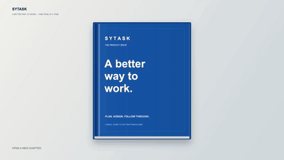
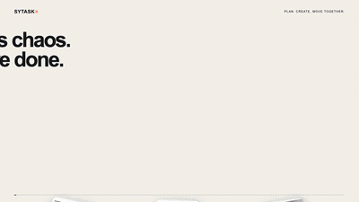

# screenshot-motion-skill — Screenshots to product demo videos

**English** | [简体中文](README.zh-CN.md)

**Give your AI coding agent screenshots. Get a product video for your next launch.**

`screenshot-motion-skill` is an open-source agent skill for Codex, Claude Code, and other local AI coding assistants. Turn app, website, or SaaS screenshots into animated product demo videos, write captions, and render a 1080p MP4 locally with Remotion.

- **Eight motion templates:** spotlight cards, dark launch films, page-turn storybooks, orbital galleries, kinetic graphics, prismatic folds, floating page stacks, and gentle fan entrances.
- **Revise in conversation:** change headlines, captions, and effects, then render again.
- **Keep editing:** receive an MP4 and a native Jianying `.jypack` with media for the original seven effects.

[Quick start](#how-to-use) · [Outputs](#what-you-get) · [Requirements](#requirements) · [FAQ](#faq)

## Effects

| Spotlight | Launch |
| :---: | :---: |
|  |  |
| **Storybook** | **Orbit** |
|  |  |
| **Kinetic** | **Prism** |
|  |  |
| **Flipstack** | **Entrance** |
|  |  |

<sub>Flipstack: normal speed · 20 fps · full 20-second motion.</sub>


<sub>Small, accelerated, silent previews. Final videos: 1080p · 30 fps.</sub>


### Eighth template: Entrance

Choose `entrance` for an 8-second video using five screenshots: cards rise in a gentle fan, product copy fills the left side, feature descriptions light up on the right, then the cards spread out and the center card lifts beneath the closing title. Copy, labels and accent color are configurable. Delivers a 1080p MP4. Native Jianying/CapCut drafts are not yet supported for Entrance. [Example configuration](examples/entrance.json) · [Copy mapping](references/templates.md#entrance--8-seconds)

## How to use

### Install with the skills CLI

Run this in your project terminal and select your agent when prompted:

```sh
npx skills add simwy/screenshot-motion-skill
```

This installs the skill and its supporting files. Rendering dependencies are separate; see [Requirements](#requirements). Prefer installing through chat? Use the instructions below.

**1. Install.** Open a local project in your app and paste the matching line into its **chat box**:

| App | Paste this to install |
| --- | --- |
| **Codex** | $skill-installer Install https://github.com/simwy/screenshot-motion-skill as screenshot-motion-skill. |
| **Claude Code** | Install https://github.com/simwy/screenshot-motion-skill into .claude/skills/screenshot-motion-skill in this project. |
| **WorkBuddy** | Install https://github.com/simwy/screenshot-motion-skill into .codebuddy/skills/screenshot-motion-skill in this project. |
| **DeepSeek Harness** | Install https://github.com/simwy/screenshot-motion-skill into .dsh/skills/screenshot-motion-skill in this project. |

Once the agent confirms installation, start a new task in the same project. These instructions target local agents with file and command access; “Claude” here means **Claude Code**. [Help with installation →](references/installation.md)

**2. Attach your screenshots.** Attach **five screenshots** in the chat box. Storybook can use 1–12 screenshots instead. You can send the images and the text below **together in one message**.

**3. Add your app details and pick an effect.** Paste this example alongside your attachments, replace the app name and description with your own, and send. The app name is simply a line of text—no separate form or command is needed.

```text
Use screenshot-motion-skill to make a promotional video from the attached screenshots.

App name: FocusFlow
Description: A task planner that helps people organize their day and stay focused.
Effect: orbit
```

`Description` is a one-sentence explanation of what your app does; you can write it in any language. Screenshots follow attachment order, and the agent writes short captions automatically. Caption language follows the app name: Chinese or mixed Chinese/English names use Chinese, English names use English, and other languages use the corresponding language. The description language does not change this choice. You can explicitly request a different order or language when needed.

Replace `orbit` with any effect above: **`spotlight` · `launch` · `storybook` · `orbit` · `kinetic` · `prism` · `flipstack` · `entrance`**.

With the prompt above, your agent writes the copy, creates the animation, checks the result, and delivers the MP4, Jianying draft bundle, and import instructions. You can then say “Change the headline” or “Replace the third screenshot.” For CapCut, add “Use CapCut instead of Jianying”; its installer requires a new empty project from your installed CapCut build.

## What you get

- **A finished MP4**, with visuals only and no audio track.
- **A Jianying `.jypack` with media**, containing replaceable screenshots and separate promotional text for the original seven templates. Entrance delivers MP4 only.

Rendering source, installation helpers and QA files stay internal; they are not extra deliverables.

## Requirements

Use a local AI coding agent with file and command access, plus **Python 3.9+, Node.js 22+, npm, Chrome / Chromium, and FFmpeg**. The agent checks the environment and runs the render; the first run requires dependency installation. See [rendering setup](references/development.md).

Native draft generation needs pyJianYingDraft 0.2.7, Pillow and the Jianying desktop client. The client creates the `.jypack` using its backup-with-media command. The receiving editor must provide **Import Jianying Draft**.

## Import your Jianying draft

1. Download the `.jypack`; **do not unzip it**.
2. On Jianying’s home screen, choose **导入剪映草稿** (Import Jianying Draft).
3. Select the file and open the imported draft to continue editing.

The agent generates the package through **备份至本地 → 备份草稿及素材** in the desktop client. Media travels with the draft, and the recipient does not run installation scripts. Use a macOS or Windows Jianying version with this import feature.

Replace screenshots while retaining effects/keyframes, and edit promotional copy in the text tracks. Text inside a screenshot remains part of the image.

Default delivery is **MP4 + `.jypack`**. Ask for “MP4 only” to skip the draft, or explicitly request CapCut for its separate workflow. [Developer export workflow →](references/jianying-jypack.md)

### CapCut option

CapCut uses its own draft workflow and a new empty project from the installed build; it does not use Jianying’s `.jypack` import.


[CapCut setup and editing details →](references/editor-export.md)

## Good to know

- Output is **1080p, 30 fps, landscape**. Spotlight: 12s · Launch: 20s · Orbit: 18s · Kinetic: 16s · Prism: 18s · Flipstack: 20s · Storybook: 32s for five pages, with adjustable holds.
- Use clear screenshots and short captions. Changing text inside a screenshot requires an updated image.
- Audio is not bundled; provide files you have permission to use. The agent checks the required local rendering tools. [Setup details →](references/development.md)
- Original code is MIT licensed; Remotion and media have separate terms. [License details →](THIRD_PARTY_NOTICES.md)

## FAQ

### Is this a web app?

This is a skill installed in a local AI coding agent. Attach screenshots and describe your video in chat; the agent runs local scripts to produce it. It is not a hosted online video editor.

### Do I need a separate video-generation API key?

Template videos render locally with Remotion, without a video-generation service API key. Your AI coding agent still needs its own account or model configuration, and that service may charge for usage.

### Is it free to use for commercial projects?

Original repository code is MIT licensed. Remotion, your AI agent, and any images, fonts, or audio have their own terms. Check the [third-party license notes](THIRD_PARTY_NOTICES.md) for commercial use.

### Can I edit text inside a screenshot?

You can revise separate video headlines and captions. Text baked into a screenshot requires an updated image. Native draft screenshot replacement, text editing, and save/export support depend on the [editor compatibility scope](references/editor-export.md).

### Can I add background music?

No. The skill generates visual-only videos without background music or sound effects.

## More effects, same skill

The template library can grow without replacing existing effects. [Contribute an effect →](references/extending.md)

Only lightweight GIF previews and the CapCut/Jianying UI showcase captures ship with the skill. Full demo videos, original screenshots, runtime dependencies, and generated editing packs stay outside the installation. [Preview details →](docs/previews/README.md)

If this skill helps with your next launch, **star the repository** to find it again. For problems, [open an issue](https://github.com/simwy/screenshot-motion-skill/issues) with your agent, OS, template name, and error details. Leave out credentials and private media.
