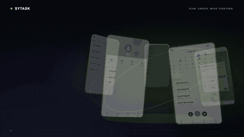

# screenshot-motion-skill

**English** | [简体中文](README.zh-CN.md)

**Your screenshots. A product video. Ready for your next launch.**

An agent skill that turns screenshots into motion, writes the captions, and delivers an MP4. All seven effects also have experimental native editable CapCut previews with separate screenshot and text layers, plus a portable installer for macOS and Windows. Windows client acceptance is pending.

## Effects

| Spotlight | Launch |
| :---: | :---: |
|  |  |
| **Storybook** | **Orbit** |
|  |  |
| **Kinetic** | **Prism** |
|  |  |
| **Flipstack** | |
|  | |

<sub>Small, accelerated, silent previews. Final videos: 1080p · 30 fps.</sub>

## Keep creating in CapCut: replace screenshots and edit page text

**All seven effects can generate native editable CapCut preview drafts.** The screenshot below shows the previously verified Storybook preview on macOS. Continue working in the desktop editor after generation: replace product screenshots, revise page copy, and refine the edit.


<sub>Actual CapCut macOS 9.7.1 capture. The book preview, independent text tracks and native Text panel are visible; screenshot images, paper and background also have their own layers.</sub>

- **Replace screenshots:** each screenshot is an image segment. Use the editor’s replacement workflow and retain effects/keyframes; check the image fit and page turn afterward.
- **Edit page copy:** cover titles, body copy, chapter labels and page numbers are native text segments available in the text panel.
- **Keep the book layout:** covers, facing pages, colors and decorations follow the template layout, with synchronized keyframes for page changes.

This optional output is a local draft folder with its media. Generation uses an isolated Python environment with pyJianYingDraft 0.2.7 and Pillow; Storybook also needs Arial (macOS, Windows, or `SCREENSHOT_MOTION_FONT_DIR`). The portable acceptance pack includes every generated effect, matching reference MP4s and a standard-library Python installer that rebuilds paths on the destination machine. CapCut requires a new empty project from that installed build. [Windows/macOS installation and acceptance →](references/windows-acceptance.md)

Ask your agent:

```text
Make a video with the selected effect and export a native editable CapCut preview draft.
Include a portable pack for macOS and Windows, with the matching reference MP4.
I want to replace screenshots and edit cover and page text in CapCut,
while preserving as much of the original layout and effect as possible.
```

The MP4 example below requests a video only. To receive the native draft as well, explicitly request it as above.

**Current scope:** draft generation covers all seven effects; destination installation handles macOS/Windows paths and readable legacy/modern draft schemas. The six newer native recipes are experimental 2D approximations, particularly simplified for Flipstack. Native perspective, mesh bending, lighting, crops and typography can differ from the original render. Only the earlier Storybook preview has client evidence: opening, cover/inner layout and text panel in CapCut macOS 9.7.1. The new all-effects bundle has not passed client acceptance; this Mac's window-control errors blocked further GUI checks, and Windows has no test machine yet. Replacement, text-edit/save/reopen and final native export remain pending. [Editing and compatibility →](references/editor-export.md)

## How to use

**1. Install.** Open a local project in your app and paste the matching line into its **chat box**:

| App | Paste this to install |
| --- | --- |
| **Codex** | $skill-installer Install https://github.com/simwy/screenshot-motion-skill as screenshot-motion-skill. |
| **Claude Code** | Install https://github.com/simwy/screenshot-motion-skill into .claude/skills/screenshot-motion-skill in this project. |
| **WorkBuddy** | Install https://github.com/simwy/screenshot-motion-skill into .codebuddy/skills/screenshot-motion-skill in this project. |
| **DeepSeek Harness** | Install https://github.com/simwy/screenshot-motion-skill into .dsh/skills/screenshot-motion-skill in this project. |

Once the agent confirms installation, start a new task in the same project. These instructions target local agents with file and command access; “Claude” here means **Claude Code**. [Help with installation →](references/installation.md)

**2. Attach your screenshots.** Attach **five screenshots** in the chat box. Storybook can use 1–12 screenshots instead. You can send the images and the text below **together in one message**.

**3. Add your app details and pick an effect.** Paste this example alongside your attachments, replace the app name and description with your own, and send. The app name is simply a line of text—no separate form or command is needed.

```text
Use screenshot-motion-skill to make a promotional video from the attached screenshots.

App name: FocusFlow
What it does: A task planner that helps people organize their day and stay focused.
Effect: orbit
Caption language: English. Write short captions for me.
Output: Export the MP4.
Screenshot order: Use the attachment order.
```

Replace `orbit` with any effect above: **`spotlight` · `launch` · `storybook` · `orbit` · `kinetic` · `prism` · `flipstack`**.

Your agent writes the copy, creates the animation, checks the result, and delivers the video. You can then say “Change the headline” or “Also export an editing pack for CapCut.”

## What you get

- **A finished MP4** and the editable Remotion source project. The source project is for rerendering through the skill; it is not a CapCut draft.
- **Optional music and sound effects** from audio you provide.
- **An optional editing pack** with clean motion clips, editable SRT captions, separate audio tracks, and your screenshots.

- **Optional native preview drafts for all seven effects in CapCut** with replaceable screenshots, separate text layers and 2D keyframes, plus matching full-effect reference videos. See the showcase above for compatibility and validation scope.

## Good to know

- Output is **1080p, 30 fps, landscape**. Spotlight: 12s · Launch: 20s · Orbit: 18s · Kinetic: 16s · Prism: 18s · Flipstack: 20s · Storybook: 32s for five pages, with adjustable holds.
- Use clear screenshots and short captions. Changing text inside a screenshot requires an updated image.
- Audio is not bundled; provide files you have permission to use. The agent checks the required local rendering tools. [Setup details →](references/development.md)
- Original code is MIT licensed; Remotion and media have separate terms. [License details →](THIRD_PARTY_NOTICES.md)

## More effects, same skill

The template library can grow without replacing existing effects. [Contribute an effect →](references/extending.md)

Only lightweight GIF previews and the CapCut/Jianying UI showcase captures ship with the skill. Full demo videos, original screenshots, runtime dependencies, and generated editing packs stay outside the installation. [Preview details →](docs/previews/README.md)
