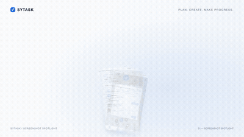
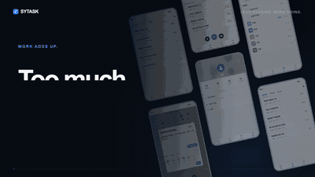
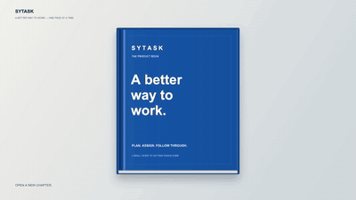
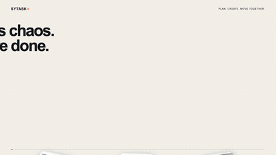
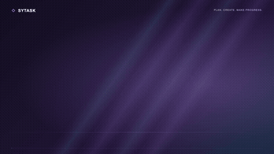
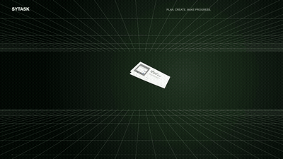

# screenshot-motion-skill — 把产品截图变成宣传视频

[English](README.md) | **简体中文**

给 AI 编程助手提供产品截图、应用名称和一句话介绍，选择一个模板，就能在本地生成带动画和宣传文案的产品视频。适合 App、网站和 SaaS 的功能展示、产品发布与社交平台宣传，无需手动编写动画代码。

你可以继续用自然语言修改标题、文案或截图，再生成视频；需要进一步剪辑时，还可以请求剪映可编辑草稿。

[怎么使用](#怎么使用) · [交付内容](#交付内容) · [模板一览](#模板一览) · [剪映导出的特点](#剪映导出的特点) · [常见问题](#常见问题)

## 模板一览

| Spotlight · 卡片聚焦 | Launch · 暗色发布片 |
| :---: | :---: |
|  |  |
| **Storybook · 翻页故事书** | **Orbit · 环绕画廊** |
|  |  |
| **Kinetic · 动态图形** | **Prism · 棱镜折叠** |
|  |  |
| **Flipstack · 卡片翻叠** | **Entrance · 轻扇形入场** |
|  |  |

## 怎么使用

### 1. 安装 skill

在项目终端运行，按提示选择你使用的 AI 编程助手：

```sh
npx skills add simwy/screenshot-motion-skill
```

安装后，在同一项目中新建任务。助手需要能够读取本地文件并执行命令。

### 2. 上传截图，描述需求

将截图和下面的文字一起发送给助手，换成自己的产品信息即可：

```text
使用 screenshot-motion-skill，把附件截图制作成产品宣传视频。

应用名称：轻计划
一句话介绍：帮助团队安排任务、查看进度的协作工具。
模板：orbit
```

除 Storybook 支持 **1–12 张**外，其余模板均需要 **恰好 5 张**截图。截图默认按附件顺序使用；需要调整顺序时请明确说明。数量不符合模板要求时，助手会请你补图、选择移除哪些图或更换模板，不会自动重复或删减截图。

助手会根据截图和介绍撰写简短文案、检查环境、渲染并检查结果。你也可以提供完整文案。文案语言默认根据应用名称判断，默认交付 MP4，无需额外填写。如需其他语言或可编辑草稿，再单独提出即可。

### 3. 修改或追加交付

继续在聊天中提出修改，例如：

```text
把主标题改成“让团队协作更轻松”，第三张截图替换为新附件。
另外生成包含素材的剪映普通草稿 ZIP，方便我继续编辑。
```

首次运行需要安装渲染依赖。环境要求为 **Python 3.9+、Node.js 22+、npm、Chrome / Chromium 和 FFmpeg**；普通草稿生成另需 pyJianYingDraft 0.2.7 和 Pillow。详见[环境配置](references/development.md)。

## 交付内容

| 内容 | 何时交付 | 用途 |
| --- | --- | --- |
| 成品 MP4 | 默认 | 1080p、30 fps、横屏，静音且不含音轨，可直接播放和分享 |
| 剪映普通草稿 ZIP | 按需，除 Entrance 外的七种模板 | 包含草稿数据、截图素材、独立文案及安装脚本，安装后继续编辑 |
| 剪映 `.jypack` | 明确要求时 | 通过剪映客户端备份生成，供接收方从“导入剪映草稿”打开 |

渲染项目与源文件保留用于后续修改，不作为默认交付。Entrance 当前交付 MP4，不提供原生剪映草稿。

## 剪映导出的特点

**截图、宣传文案与动画图层可以分开编辑。** 草稿包含原始截图、原生文字片段和关键帧，方便替换产品界面、修改标题、调整排版并继续剪辑。截图内部的文字仍是图片像素，需要更换截图。

- **七种模板有原生草稿方案**：Spotlight、Launch、Storybook、Orbit、Kinetic、Prism、Flipstack；Entrance 暂不支持。
- **动效为原生近似还原**：剪映草稿不会逐像素复现 Remotion 的透视、曲面翻页、阴影、模糊和字体效果。需要完整模板效果时，以成品 MP4 为准。
- **替换时保留效果**：剪映中使用“替换片段”，并勾选“复用原视频效果”，可保留位置和关键帧。同一截图出现在多个片段时，需要逐处替换或让助手重新生成。
- **兼容性需按版本验证**：已有 macOS 剪映 11.8.0 的 Storybook 打开和截图替换记录；其他六种方案仍属实验性。全模板安装包及 Windows 客户端尚未完成完整界面验收，不能视为所有版本均已验证。


### 普通 ZIP 和 .jypack 怎么选？

| | 普通草稿 ZIP | `.jypack` |
| --- | --- | --- |
| 生成条件 | 无需安装剪映客户端 | 需要剪映桌面客户端及操作能力 |
| 接收方操作 | 解压，按附带说明用 Python 安装到实际草稿目录，再用剪映打开 | 无需解压，从剪映首页“导入剪映草稿”导入 |
| 素材 | 随包携带，安装时修正路径 | 通过客户端“备份草稿及素材”随包携带 |

**普通 ZIP 不能直接用于“导入剪映草稿”，也不能改后缀冒充 `.jypack`。** 如需后者，请明确说“交付 MP4 和包含素材的剪映 .jypack 草稿”。接收端需有对应导入功能。

CapCut 请单独指定，它使用独立适配流程，需要目标版本创建的空白项目，不能直接套用剪映 `.jypack`。更多细节见[编辑器兼容性](references/editor-export.md)与[.jypack 导出说明](references/jianying-jypack.md)。

## 常见问题

### 需要会写代码或操作剪映吗？

日常使用通过聊天提出需求，由助手运行脚本。只要成品 MP4，无需剪映；需要草稿继续编辑时，才需要相应桌面编辑器。初次使用仍需准备上述本地运行环境。

### 这是网页应用吗？

这是安装在本地 AI 编程助手中的 skill，不是托管的在线视频编辑器。开发者也可直接调用生成引擎，见[程序入口与云端集成](references/engine.md)。

### 需要额外的视频生成 API Key 吗？

视频使用固定模板，通过本地 Remotion 渲染，不需要视频生成服务的 API Key。AI 助手本身仍需账号或模型配置，其服务可能收费。

### 可以只提供截图，让助手写文案吗？

可以，同时提供产品名称和一句话介绍即可。也可指定每张截图对应的标题、说明与语言。文案过长或替换截图比例变化时，可能需要调整排版。

### 可以修改截图里面的文字吗？

独立标题和宣传文案可以修改；截图内部文字需要提供更新后的图片。

### 可以添加背景音乐或配音吗？

当前 skill 只生成静音画面，不添加背景音乐、音效或旁白。你可以在后续剪辑时自行添加有权使用的音频。

### 草稿和视频为什么看起来不完全一样？

两者使用不同动画能力。MP4 保留模板完整渲染效果；原生草稿优先提供可编辑图片、文字和关键帧，部分复杂动效会简化。保存、重新打开及最终导出仍需在目标客户端验证。

### 可以免费使用或用于商业项目吗？

原创代码采用 MIT 许可证；Remotion、AI 助手及图片、字体等素材适用各自条款。商业使用前请查看[第三方许可说明](THIRD_PARTY_NOTICES.md)。

### 运行报错怎么办？

先让助手检查依赖和截图数量。提交 [Issue](https://github.com/simwy/screenshot-motion-skill/issues) 时，请附上操作系统、AI 助手、模板名称和错误信息；不要附带密钥或私人素材。

## 更多资料

[配置说明](references/configuration.md) · [模板参数](references/templates.md) · [开发与环境配置](references/development.md) · [扩展新模板](references/extending.md) · [预览说明](docs/previews/README.md)
