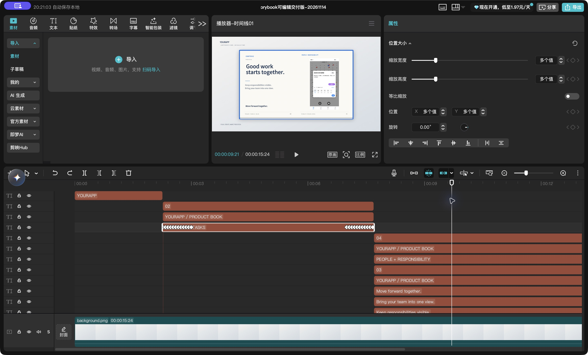

# screenshot-motion-skill

[English](README.md) | **简体中文**

**用你的截图，制作下一次产品发布的宣传视频。**

这个 AI 技能可以将截图制作成动画，撰写字幕文案，并交付 MP4 视频。全部 7 种效果还可生成剪映原生可编辑预览草稿，分别保留截图、文字和二维关键帧，并提供 macOS / Windows 可迁移安装包。Windows 客户端尚待实机验收。

## 动画效果

| Spotlight · 卡片聚焦 | Launch · 暗色发布片 |
| :---: | :---: |
|  |  |
| **Storybook · 翻页故事书** | **Orbit · 环绕画廊** |
|  |  |
| **Kinetic · 动态图形** | **Prism · 棱镜折叠** |
|  |  |
| **Flipstack · 卡片翻叠** | |
|  | |

<sub>以上为缩小、加速的静音预览。最终视频：1080p · 30 fps。</sub>

## 在剪映中继续创作：换截图、改书页文字

**全部 7 种效果可生成剪映原生可编辑预览草稿。** 下图为此前在 macOS 实测的 Storybook 草稿。 生成视频后，还可以在剪映里替换产品截图、调整书页文案，并继续剪辑。



<sub>Mac 剪映 11.8.0 实机截图。上方是书页效果，下方是独立文字轨道；图片、纸张和背景也分别位于各自的图层中。</sub>

- **替换截图**：截图作为独立图片片段导入；使用“替换片段”并勾选“复用原视频效果”，保留位置和关键帧。
- **修改书页文字**：封面标题、正文、章节、页码都是原生文字片段，可在剪映文本面板中调整。
- **保留书本布局**：封面、左右页、配色和装饰按模板布局导出，页面切换使用同步关键帧。

此项交付是包含素材的本地草稿文件夹。生成需要安装 pyJianYingDraft 0.2.7 和 Pillow 的独立 Python 环境；Storybook 还需 Arial 字体，支持 macOS、Windows 字体目录或 `SCREENSHOT_MOTION_FONT_DIR`。可迁移验收包包含各效果草稿、完整效果参考 MP4 和 Python 标准库安装器，安装时按目标电脑重建素材路径。具备本地工具和权限时，由 AI 执行这些步骤。[Windows / macOS 安装与验收 →](references/windows-acceptance.md)

直接对 AI 说：

```text
用选定的特效制作视频，并导出剪映原生可编辑预览草稿。
同时提供 macOS / Windows 可迁移验收包和对应的完整效果参考视频。
我需要在剪映里替换截图、修改封面和书页文字，尽量保留原版布局与效果。
```

下方的 MP4 用法示例默认只请求视频；需要原生草稿时，请像上面一样明确提出。

**当前范围：** 全部 7 种效果已实现原生草稿生成，安装器适配 macOS / Windows 路径及可读的旧版、新版草稿结构。新增 6 种原生模式属于实验性二维近似，尤其 Flipstack 的原生翻页较简化；透视、纸张弯曲、光影、裁剪和字体不与原始渲染完全一致。此前在 Mac 剪映 11.8.0 验证的是 Storybook 打开、版式和截图替换。本次全特效包尚未完成客户端验收：Mac 窗口控制错误阻止了进一步 GUI 检查，Windows 暂无测试环境；文字修改后的保存重开和原生成片导出仍待验证。CapCut 使用独立验收结果，见英文版与兼容性说明。[编辑与兼容性说明 →](references/editor-export.md)

## 使用方法

**1. 安装技能。** 在你使用的工具中打开一个本地项目，将对应指令粘贴到它的**聊天输入框**中：

| 工具 | 复制这段指令进行安装 |
| --- | --- |
| **Codex** | $skill-installer 将 https://github.com/simwy/screenshot-motion-skill 安装为 screenshot-motion-skill。 |
| **Claude Code** | 将 https://github.com/simwy/screenshot-motion-skill 安装到当前项目的 .claude/skills/screenshot-motion-skill 目录。 |
| **WorkBuddy** | 将 https://github.com/simwy/screenshot-motion-skill 安装到当前项目的 .codebuddy/skills/screenshot-motion-skill 目录。 |
| **DeepSeek Harness** | 将 https://github.com/simwy/screenshot-motion-skill 安装到当前项目的 .dsh/skills/screenshot-motion-skill 目录。 |

AI 确认安装完成后，在同一项目中新建任务。以上说明适用于能够访问本地文件和执行命令的 AI 工具；这里的“Claude”指 **Claude Code**。[安装帮助（英文）→](references/installation.md)

**2. 添加截图附件。** 在聊天输入框中上传 **5 张截图**。Storybook 支持 1–12 张截图。**截图和下一步的文字可以放在同一条消息里一起发送。**

**3. 填写应用信息并选择效果。** 将下面的示例粘贴到附有截图的消息中，替换应用名称和一句话介绍后发送。应用名称就是普通文字中的一行，无需单独填写表单或使用特殊命令。

```text
使用 screenshot-motion-skill，把附件中的截图制作成宣传视频。

App 名称：诗柚古文
一句话介绍：一款帮助学生轻松学习古诗词和文言文的 App。
效果：orbit
文案语言：英文，请自动撰写简短文案。
输出：导出 MP4。
截图顺序：请按附件上传顺序展示。
```

将 `orbit` 替换为你喜欢的效果：**`spotlight` · `launch` · `storybook` · `orbit` · `kinetic` · `prism` · `flipstack`**。

指令可以用中文；如果希望视频使用中文文案，将“文案语言”改成“中文”即可。

AI 会撰写文案、制作动画、检查结果并交付视频。随后你可以继续说：“修改主标题”，或“再导出一份用于剪映的编辑素材包”。

## 交付内容

- **制作完成的 MP4 视频**和可编辑的 Remotion 渲染源项目。源项目用于通过 skill 修改、重新渲染，不等于剪映草稿。
- **可选的音乐与音效**，使用你提供的音频文件。
- **可选的编辑素材包**，包含不带字幕的动画片段、可编辑的 SRT 字幕、独立音轨以及原始截图。

- **可选的全部 7 种效果剪映原生预览草稿**，含可替换截图、独立文字图层和二维关键帧，并附完整效果参考视频。具体兼容性与验证范围见上方展示区。

## 使用须知

- 默认输出为 **1080p、30 fps、横屏**。Spotlight：12 秒；Launch：20 秒；Orbit：18 秒；Kinetic：16 秒；Prism：18 秒；Flipstack：20 秒；Storybook：5 页时为 32 秒，可调整停留时长。
- 请使用清晰的截图和简短文案。若要修改截图内部的文字，需要提供更新后的图片。
- 技能不附带音频；请提供你有权使用的文件。AI 会检查本地渲染所需工具。[环境配置说明（英文）→](references/development.md)
- 原创代码采用 MIT 许可证；Remotion 和媒体素材适用各自的条款。[许可证详情（英文）→](THIRD_PARTY_NOTICES.md)

## 扩展更多效果

模板库可以持续增加新效果，无需替换已有模板。[贡献新效果（英文）→](references/extending.md)

技能仅附带轻量 GIF 预览及中英文版对应的剪映、CapCut 实机展示截图。完整演示视频、原始截图、运行依赖和生成的编辑素材包不包含在安装内容中。[预览说明（英文）→](docs/previews/README.md)
